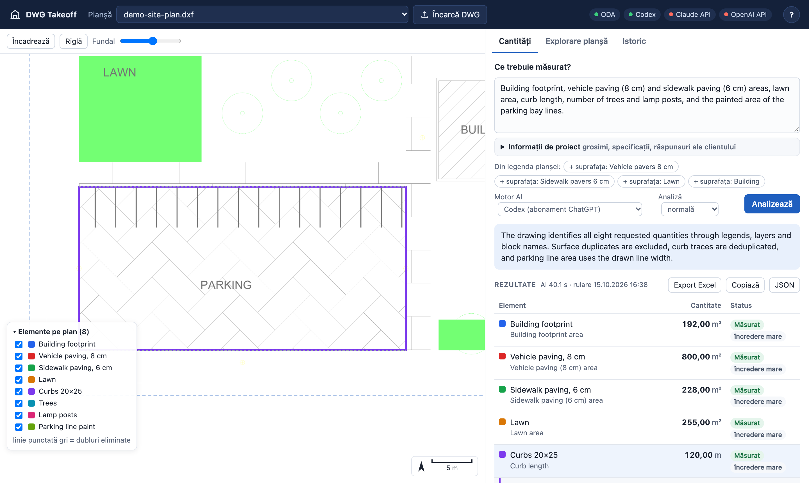

# DWG Takeoff

[](https://github.com/mihaicristianfarcas/dwg-takeoff/actions/workflows/ci.yml)
[](LICENSE)

Quantity takeoff from CAD drawings. Open a `.dwg` or `.dxf`, ask in plain words — *"paving area by
thickness, curb length, lawn area, number of trees, concrete in the foundations"* — and get
quantities you can check **entity by entity**: every number comes with its formula, the drawing
entities it was measured on (with their AutoCAD handles), what was de-duplicated and why, and the
geometry highlighted on the plan.



**The AI never produces a number.** A deterministic step first breaks the drawing into a numbered
*catalogue* of everything measurable (each fill, outline, line group and block type, already
measured and linked to the legend, labels, callouts and room schedules). The AI only decides
*which* entries answer the request, how to measure them and which factors apply (thicknesses,
depths), as a schema-checked JSON plan. A geometry engine then measures the plan, and the AI checks
what was measured before the answer is shown. Assumed values are marked as such and editable.

```
DWG ─ODA File Converter→ DXF ─ezdxf + shapely→ Drawing ──→ catalogue + digest (deterministic)
                                                                    │
                     request ──→ AI (Codex / Claude / OpenAI) picks entries, measures, factors
                                                                    │  JSON plan
                                  engine measures ◀──────────────────┘   (unions, de-duplication,
                                        │                                  formulas, evidence)
                                        ▼
                          AI review of the measured plan ─→ web UI · Excel · CLI
```

## Features

- **Reads real drawings**: DWG (via the free ODA File Converter) and DXF; nested and dynamic blocks,
  hatches with islands, MPOLYGON, MLINE, true colours, frozen layers, drawings made on a sheet;
  legends on sheets and in model space; Excel / Word tables embedded in the drawing, AutoCAD
  tables and tables drawn as text; setting-out coordinate tables georeferenced onto the plan.
- **Units you can trust**: the header is checked against dimensions, objects of known size and
  survey notation; the source and the evidence are shown, and a ruler calibrates the scale on any
  known length.
- **The element catalogue**: a deterministic, numbered breakdown of the drawing with names from
  the legend, callouts, texts and room schedules, duplicates and relations; labels are editable
  and remembered per drawing ([docs/catalogue.md](docs/catalogue.md)).
- **Measurements that handle real drafting**: surfaces drawn twice counted once, curbs drawn with
  both faces or several times de-duplicated, boundaries drawn as separate lines closed, symbols
  drawn without blocks grouped and counted, painted stripes from polyline widths
  ([docs/engine.md](docs/engine.md)).
- **Three AI backends** with the same instructions and schema: the Codex CLI with a ChatGPT
  subscription (default), the Claude API, the OpenAI API ([docs/ai.md](docs/ai.md)).
- **Verifiable answers**: per-entity evidence, formulas with factor origins (*from the drawing*,
  *from documents*, *assumed*), double-counting checks, the full AI audit trail of every run, an
  AutoLISP snippet that selects the counted entities in AutoCAD, Excel export with live formulas.
- **Correct without re-asking**: edit factors, tolerances and sources, add catalogue entries as
  items — everything recomputes instantly.

The web interface is in Romanian (the tool was built for Romanian construction cost estimating);
the AI answers in the language of the request. Code, documentation and the catalogue vocabulary
are in English.

## Quick start

Requirements: Python 3.12+, [uv](https://docs.astral.sh/uv/), the free
[ODA File Converter](https://www.opendesign.com/guestfiles/oda_file_converter) for `.dwg` files
(not needed for `.dxf`), and one AI backend.

```bash
git clone https://github.com/mihaicristianfarcas/dwg-takeoff.git
cd dwg-takeoff
uv sync
codex login                      # default AI backend: the Codex CLI (npm i -g @openai/codex)
                                 # or: export ANTHROPIC_API_KEY=… / OPENAI_API_KEY=…
uv run dwg-takeoff serve         # http://127.0.0.1:8765
```

Upload a drawing (button or drag and drop), or put drawings in `samples/` to load them at startup.
To try it without a drawing of your own, use the demo site plan:

```bash
DWG_TAKEOFF_SAMPLES=examples uv run dwg-takeoff serve
uv run dwg-takeoff ask examples/demo-site-plan.dxf "building footprint, paving areas, curb length, number of trees"
```

More in [docs/getting-started.md](docs/getting-started.md).

## Documentation

| | |
|---|---|
| [Getting started](docs/getting-started.md) | installation on macOS / Linux / Windows, AI backends, first takeoff |
| [User guide](docs/user-guide.md) | the web interface: asking, checking, correcting, exporting |
| [How it works](docs/architecture.md) | the pipeline, the code layout, caching and data |
| [The element catalogue](docs/catalogue.md) | how a drawing is broken down and named, field by field |
| [The AI planner](docs/ai.md) | backends, prompt, plan schema, validation, the review pass |
| [The measurement engine](docs/engine.md) | measures, de-duplication, factors, checks, evidence |
| [CLI](docs/cli.md) · [HTTP API](docs/web-api.md) · [Configuration](docs/configuration.md) | reference |
| [Evaluation](docs/evaluation.md) | results on public drawings, speed, what was tested |
| [Development](docs/development.md) | setup, tests, lint, conventions, extending the app |

Coding agents: see [AGENTS.md](AGENTS.md). The `dwg-catalogue` skill
([SKILL.md](src/dwg_takeoff/ai/skills/dwg-catalogue/SKILL.md)) teaches an AI to read the catalogue;
the app sends it with every request and it is installed for Claude Code and Codex in this repository.

## Status and limitations

Alpha: used on real site plans, tested on 40 public drawings, but young. Known limitations:

- The ODA File Converter is free to use but closed source; it must be installed separately.
- External references (xrefs) are not loaded; missing ones are listed.
- Thicknesses, depths and sections are rarely on a site plan: volumes use assumed factors (marked,
  editable, and asked about) unless you add the client's answers or reference documents
  (road-structure details, foundation plans) as project information.
- The catalogue vocabulary is English; layer names in other languages get no category (their
  legend labels, callouts and texts still name them).
- A takeoff with the review takes about 40 s on a small drawing and 1½–4 min on a large one with the
  Codex backend, almost all of it the model writing the plan.

See [docs/evaluation.md](docs/evaluation.md) for what was tested and how.

## Contributing and security

Contributions are welcome — see [CONTRIBUTING.md](CONTRIBUTING.md). The server is meant to run on
your own machine; read [SECURITY.md](SECURITY.md) before exposing it to a network, and note that
a summary of the drawing is sent to the AI provider you choose.

## License

[MIT](LICENSE). The ODA File Converter, Codex CLI and AI APIs are separate products under their
own terms.
