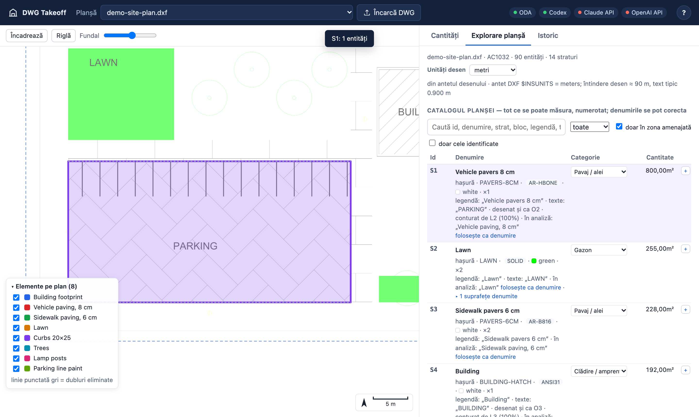

# User guide

The interface is in Romanian; labels are quoted below as they appear on screen, with a translation.

## The screen

- **Top bar** — *Planșă* (the drawing; the address keeps it as `#p=<id>`, so a reload or a shared
  link opens the same one), *Încarcă DWG* (upload; dragging a file onto the page works too), status
  chips (green: the ODA converter and each AI backend that is ready; hover for details) and *?*
  (a short how-to).
- **The plan** on the left: the drawing as a CAD-faithful image (the site region, or the whole
  drawing), with the measured geometry drawn over it. Wheel / pinch zooms, dragging pans;
  `+` `−` `0` and the arrow keys work when the plan has focus. Zoomed in, sharper tiles load for the
  visible area. *Încadrează* fits the view, *Orientare planșă / Nord în sus* switches between the
  sheet's rotation and north up, *Fundal* sets the opacity of the drawing under the overlays.
- **Three tabs** on the right: *Cantități* (quantities: ask and check), *Explorare planșă* (what
  the drawing holds), *Istoric* (earlier analyses of this drawing).

## Check the units first

Every quantity depends on the drawing units. They are read from the drawing header and checked
against linear dimensions, objects of known size (cars, doors, benches, trees) and survey
notation in the texts. When they are inferred, assumed or doubtful, a banner on the plan says so,
with the evidence (*Unități: … (deduse din desen)*). Change them there or in *Explorare planșă →
Unități desen*; every quantity is recomputed.

If no standard unit fits (drawings made at plot scale), use the ruler: *Riglă*, click two points
whose real distance you know, then *Calibrează unitățile…* and type the real length in metres.

The **ruler** also measures on its own: click points to get the segment and total length,
double-click to close the polygon and get its area, `Esc` to start over.

## Ask

Type the request in *Ce trebuie măsurat?* in the client's own words, in any language. *Din
legenda planșei* offers the drawing's legend labels as one-click additions. Choose the AI backend
(*Motor AI*) and the depth (*Analiză*: *rapidă*, *normală*, *aprofundată* — normal is the
default: deeper took longer for the same quantities in our tests) and press *Analizează*
(`Ctrl/⌘+Enter`).

While it works you see a timeline: the drawing prepared, the AI's own notes, every lookup it makes
in the drawing and how many results it found, the review of the measured plan, the token usage,
and a progress bar estimated from earlier runs. *Anulează* cancels.

If the same request was already analysed on this drawing, a hint offers the earlier result
instantly.

### Project information

Volumes need thicknesses, depths and sections that a site plan rarely has. *Informații de proiect*
keeps, per drawing, **notes** (the client's answers, specifications) and **reference documents**
(PDF, DWG/DXF, text: road-structure details, foundation plans, technical specifications). The AI
reads them — they are never measured — and the values it takes from them become factors marked
*din documente* (from documents) instead of *presupus* (assumed). Each open question of the AI has a
*Răspunde* button that copies it into the notes, ready for the answer.

## Read the answer

The results table lists one row per requested quantity with its value, unit, status and the AI's
confidence:

| Status | Meaning |
|---|---|
| *Măsurat* | measured from the geometry only |
| *Cu ipoteze* | uses at least one assumed factor (e.g. a thickness) — check it |
| *Lipsă în planșă* | the drawing does not contain this information; the AI says which document would |

Above the table: the AI's summary, the run time and *Verificarea AI* — the outcome of the AI's
check of what its plan measured (confirmed, or which items it corrected and why; corrected items
carry a badge). *Verificări automate* lists double counting the engine found (the same surface or
curb in two items).

Click a row to open it. You get:

- **the formula** — e.g. `1 234,35 m² × 0,08 m (grosime, presupus) = 98,75 m³`;
- **the components** — what was measured and how (*arie*, *lungime*, *număr*…), the catalogue
  entries or filters used (*Surse*), the statistics (drawn vs counted, tolerance, groups);
- **the factors** with their origin: *din planșă* (written on the drawing), *din documente*,
  *presupus* (yellow);
- **the evidence** — every entity used, with its AutoCAD handle, layer, type, pattern, its own
  value and the value actually counted after de-duplication, with the reason ("dublură…",
  "suprapus parțial…"). Click a row to locate the entity on the plan. *Copiază selecția pentru
  AutoCAD (AutoLISP)* copies a snippet that selects exactly those entities in AutoCAD;
- **the AI's reasoning, assumptions and questions** (*Raționament*, *Ipoteze*, *Întrebări*);
- **Trasabilitate AI** — the exact prompt, the plan, the logs, the measurement report of the review.

On the plan, the items are drawn in their colours (the panel *Elemente pe plan* toggles them);
dotted grey lines are traces removed as duplicates.

## Correct without asking again

In an open item: change a factor value, add a factor (*+ factor*, e.g. a thickness turning an area
into a volume), change the de-duplication tolerance, remove a source (×), rename or delete the item.
From the catalogue, *+* adds any entry as a new item. Everything recomputes immediately, without the
AI; *Salvează* stores the edited version as a new run (the AI's run stays untouched).

## Explore the drawing

*Explorare planșă* shows the drawing's summary and units, warnings, then **the catalogue**: every
measurable group of entities, numbered (`S` fills, `O` outlines, `L` lines, `B` blocks, `N` blocks
inside blocks, `T` table footprints; `O2.3` is one named surface of `O2`, such as a room), with its
quantity and the evidence: legend label, texts written inside, callouts, duplicates, edges. Filters:
search, kind, *doar în zona amenajată* (inside the site region), *doar cele identificate* (named
or categorised only). Click a row to highlight it on the plan; the triangle opens the named surfaces
of an entry.

**Labels are editable**: type a name in *Denumire*, pick a *Categorie*. They are stored for the
drawing and the next question sees them as confirmed (*user*) — the most trusted evidence. After an
analysis, each entry shows the item that measured it (*în analiză: …*); *folosește ca denumire*
adopts that name in one click, so the drawing gets better named with every confirmed answer.

Below: the legends found, the sheets, the tables (also tables drawn as text) and the long notes.

## Export

*Export Excel* writes a workbook: *Rezumat* (quantities, formulas, assumptions), *Componente*
(each measured value and each factor in its own cell — the yellow cells are factors, and the
quantities and totals are Excel formulas, so changing a thickness in Excel updates the takeoff),
*Entități* (per-entity evidence with handles), *Raționament*, *Info* (drawing units and their
source, AI backend and model, the run). *Copiază* puts the table on the clipboard; *JSON* downloads
the full result.

## History

*Istoric* lists every analysis of the drawing with its request, size, time, backend and whether it
was edited. Opening one re-measures its saved plan with the current engine (the plan is unchanged);
*șterge* hides it (the folder is kept on disk for the audit trail).
